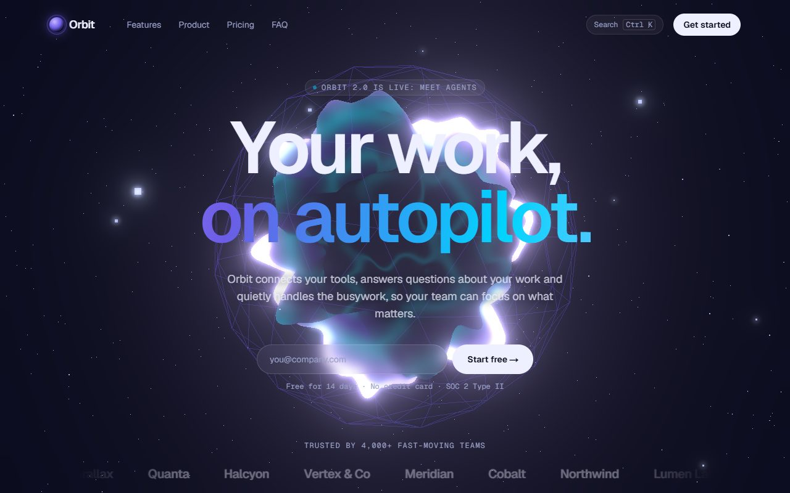

# Orbit AI

**SaaS landing page** · a concept project by [Mayank Mehra](https://mayankmehra.pages.dev)

[](https://orbit-ai-b4e.pages.dev)

**Live site:** https://orbit-ai-b4e.pages.dev

## The brief

An AI startup launch page that had to look premium, explain the product fast, and convert visitors to sign-ups.

## Signature moment

A shader-built orb with bloom that follows you through the whole page.

## What I built

- Custom GLSL orb with bloom post-processing
- Pinned, scroll-scrubbed product tour
- Odometer pricing toggle and decoding stats
- ⌘K command palette for keyboard users

## Tech

Next.js · Three.js shaders (GLSL) · GSAP · Lenis

## Run it locally

```bash
npm install
npm run dev       # http://localhost:3000
npm run build     # static export in out/
```

---

More of my work: **[mayankmehra.pages.dev](https://mayankmehra.pages.dev)**
